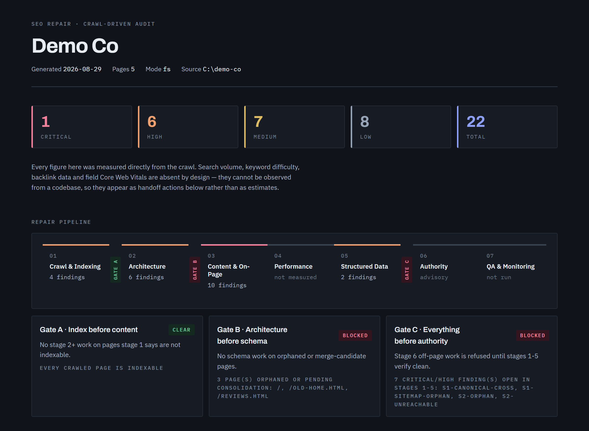

# sitemend

[](https://github.com/SurendharVr/seo-repair/actions/workflows/tests.yml)
[](LICENSE)

**Find the SEO problems Google actually penalises, then fix them in your code.**

Built for developers and site owners who keep their site in a codebase and want SEO
fixes as reviewable diffs, not a PDF of warnings. You approve every change before it's
applied.

A [Claude Code](https://claude.com/claude-code) skill: a site crawler and audit tool that finds indexing problems, orphan pages, duplicate
content, broken internal links, thin content, missing canonical tags, keyword
cannibalization and invalid schema markup — then proposes the fixes, applies the ones
you approve, and re-verifies with a second crawl.

`sitemend` is the PyPI package and command-line name. Inside Claude Code the skill and
plugin are still called `seo-repair`.

What makes it different from a checklist: **the order is enforced.** SEO findings are
not independent, so this treats them as a repair system with a dependency order.

```
Crawl → Index → Architecture → Content → On-Page → Performance → Schema → Authority → Monitor
```

Work done out of order is wasted. Optimising a title on a page Google cannot index
changes nothing. Writing schema for a page about to be merged away is thrown out with
the page. Building links to either is the most expensive mistake of the three. Three
**gates** make that ordering unskippable rather than advisory.

---

## What a run looks like

Auditing the bundled demo site — the gate lines are the point, and they say *why*, not just *blocked*:

```console
$ python audit.py --crawl crawl.json --schema schema.json --out findings.json
24 findings: 1 critical, 7 high, 7 medium, 9 low
  stage 1: 5
  stage 2: 6
  stage 3: 11
  stage 5: 2
  gate A (Index before content): CLEAR -- every crawled page is indexable
  gate B (Architecture before schema): BLOCKED -- 3 page(s) orphaned or pending consolidation: /, /old-home.html, /reviews.html
  gate C (Everything before authority): BLOCKED -- 8 critical/high finding(s) open in stages 1-5: S1-CANONICAL-CROSS, S1-PLACEHOLDER-DOMAIN, S1-SITEMAP-ORPHAN, S2-ORPHAN
```

Each run also produces a self-contained HTML dashboard:



Note stage 04. Lighthouse was not run here, so Performance reads **not measured** rather
than *clear* — a stage that produced no findings because nobody looked at it is not a
stage that passed, and the dashboard will not imply otherwise.

---

## Two things that make it different

**It refuses to invent numbers.** Search volume, keyword difficulty, backlink counts and
field Core Web Vitals cannot be observed from a codebase. They are never estimated —
they become a handoff list naming the exact Search Console or Ahrefs report to open.
Every claim in a report is tagged `MEASURED` (observed directly), `INFERRED` (reasoned
from observation, stated as such), or `HANDOFF` (not observable here). A local crawl
proves a page is *crawlable*; it never proves the page is *indexed*, and the report will
not blur those.

The same standard applies to what it writes: no invented author bios, testimonials,
ratings or trust claims. A tool that refuses to guess at keyword volume has no business
guessing at a person's credentials.

**It checks whether your structured data is honest.** Most validators check that schema
parses and has its required properties. This one also checks whether the markup asserts
things the page never shows — a rating nobody can see, an address that appears nowhere,
or review markup naming people the page does not mention. That last one is a Google
rich-results policy violation and a manual-action risk, and a property-checker will
never catch it.

## Versus asking for an SEO audit

The alternative to a tool like this is pasting a page into a chat and asking for an SEO
audit. That gives you advice. This gives you a crawl, with the differences that follow
from that:

| | A checklist prompt | seo-repair |
| --- | --- | --- |
| **Coverage** | The pages you paste or open, one at a time | Every page, from a folder or a live URL (200 by default), plus `robots.txt` and `sitemap.xml` |
| **What it sees** | Text or markup you supply | Real status codes and redirects, canonicals, internal links, orphans, click depth |
| **Repeatable** | Wording and findings can differ run to run | Same site, same crawl, same findings. `verify` diffs a new run against a baseline |
| **Evidence** | Advice in prose | Each finding names the page and cites the offending string |
| **Order of work** | One flat list | Dependency order, with three gates enforced in code: no content work on pages Google cannot index, no schema on orphaned pages, no link building while critical findings are open |
| **Numbers it cannot measure** | Nothing in a prompt stops a plausible figure | Never stated. Volume, difficulty, backlinks and field Core Web Vitals become a handoff list naming the report to open |
| **Structured data** | Required properties, if it checks at all | Required properties, and whether the markup claims things the page never shows, such as review authors |
| **Applying fixes** | Suggestions | One approved batch at a time, then a re-crawl to confirm it worked. Nothing is edited without approval |
| **In CI** | No | `--fail-on` sets the exit code. An example GitHub Action is in `examples/` |
| **Tested** | Not testable | 146 tests, many pinned to false positives found on real runs |

**How big is the gap?** We measured it on the demo site (5 pages, 14 planted defects).
Three plain "audit this site" runs by an AI agent with read-only file access found 14, 12
and 13 of the defects, with one false alarm between them. seo-repair found all 14 with no
false alarms, gave identical findings on two runs, and took about 3 seconds without using
a language model. On a site this small a good prompt does well, and it noticed things
seo-repair does not check, such as a placeholder domain in the sitemap and missing Open
Graph tags. The advantage is repeatability, scale and CI, not a better score on five
pages. The demo was built around what seo-repair detects, and this was one model and three
runs, so read it as an example, not a benchmark.

A prompt is the better tool for work that needs the live search results: keyword
research, reading what the top-ranking pages cover, and writing or rewriting content.
seo-repair does not do that, and hands it off by design. Use them in that order: fix
what stops a page being crawled and indexed first, then decide what it should say.

---

## Works with

- **Full workflow:** Claude Code (audit, plan, apply, verify).
- **Standalone:** one command, `sitemend audit <folder|URL>` (or
  `python scripts/seo_repair.py audit ...` from a clone), runs the whole pipeline on
  plain Python 3.9+. No agent needed. See below.
- **Tested on:** Linux, macOS and Windows. The Lighthouse step is verified on Windows only.

## Install

**As a plugin:**

```
/plugin marketplace add SurendharVr/seo-repair
```

**Or clone straight into your skills directory:**

```bash
git clone https://github.com/SurendharVr/seo-repair ~/.claude/skills/seo-repair
pip install -r ~/.claude/skills/seo-repair/requirements.txt
```

**Or as a command-line tool, without Claude Code:**

```bash
pip install sitemend
sitemend audit ./my-site
```

(For unreleased changes on `main`: `pip install git+https://github.com/SurendharVr/sitemend`.)

Requires Python 3.9+ with `beautifulsoup4`, `lxml` and `requests` (`pip` installs them;
from a clone, `requirements.txt` lists them). Core Web Vitals and `--render` additionally
need a local Chrome, Chromium or Edge; Core Web Vitals also need Node, via
`npx lighthouse`.

## Use it without an agent

One command audits a site folder or a live URL and writes a report and dashboard. It
edits nothing in the site.

```bash
python scripts/seo_repair.py audit ./my-site              # or https://example.com
python scripts/seo_repair.py audit ./my-site --fail-on high   # exit 1 if a high/critical finding is open (CI gate)
python scripts/seo_repair.py verify ./my-site --baseline seo-repair-out/findings.json
```

To guard a site on every pull request, copy
[`examples/github-action/seo-repair.yml`](examples/github-action/seo-repair.yml) to
`.github/workflows/`. It fails the check when a critical finding is open and attaches
the report and dashboard to the run.

Output lands in `./seo-repair-out`: `findings.json`, `SEO-REPORT-<date>.md` and a
self-contained `dashboard.html`. Applying fixes stays a Claude Code job, because each
edit needs your approval.

## Try it on the demo site

The repo ships a small site with defects planted on purpose — an orphan duplicate, a
thin page, an oversized image behind `<picture>`, review markup for someone the page
never names, and more:

```bash
cd scripts
python crawl.py        --root ../examples/demo-site --out /tmp/crawl.json
python schema_check.py --crawl /tmp/crawl.json      --out /tmp/schema.json
python audit.py        --crawl /tmp/crawl.json --schema /tmp/schema.json --out /tmp/findings.json
```

[`examples/demo-site/EXPECTED.md`](examples/demo-site/EXPECTED.md) lists exactly what a
correct run reports — **and what it must stay silent about**, which is the harder half.

## Usage

Four verbs, driven through Claude Code:

| Verb | Does | Writes |
| --- | --- | --- |
| `seo-repair audit <path>` | Crawl → audit → report. Establishes the baseline. | report only |
| `seo-repair plan` | Ranks findings into stage-ordered batches, previews each diff | nothing |
| `seo-repair apply <batch>` | Applies **one approved batch**, re-checks that stage | source files |
| `seo-repair verify` | Re-crawl, diff vs. baseline, regression gate | report only |

Nothing is edited without approval. `plan` refuses to run without a baseline; `apply`
refuses without a named, approved batch.

## What it finds

| Stage | Checks |
| --- | --- |
| **Crawling & indexing** | `robots.txt` rules, XML sitemap coverage and contradictions, `noindex` directives, canonical tags (missing, cross-page, broken, off-origin), placeholder domains (example.com, localhost) in canonicals and the sitemap, broken internal links, URL hygiene, redirect chains and loops, mixed content, `hreflang` (invalid codes, broken targets, missing self and return tags), sitemap `<lastmod>` validity, response security headers, and client-rendered shells (`--render` compares raw HTML to the rendered DOM) |
| **Site architecture** | Orphan pages, unreachable pages, click depth, internal link distribution, heading structure, breadcrumbs |
| **Content & on-page** | Duplicate and near-duplicate content (MinHash), keyword cannibalization, thin content, title tags, meta descriptions, Open Graph tags, image alt text, oversized images, unused assets |
| **Core Web Vitals** | Lighthouse LCP, CLS and TBT — reported as *lab* metrics, with the localhost caveat stated |
| **Schema markup** | JSON-LD validity, required and recommended properties, and whether the markup's claims are corroborated by visible page text |
| **Authority / off-page** | Advisory only. It cannot measure a backlink profile and does not pretend to — it produces a human action list, and refuses paid-link and PBN tactics outright |

Findings cite the offending string from your source, so every one is checkable.

## Limitations, stated plainly

- **JS rendering is for live URLs.** `seo-repair audit https://... --render` parses
  Chrome's post-JavaScript DOM with a local Chrome, Chromium or Edge, for up to 50 pages
  (`--render-limit`, about 5 seconds each, one browser launch per page). A folder has no
  running site to render, so fs mode only gets the static-shell hint `S1-JS-SHELL`. The
  mobile-overflow check is still Claude Code only (it uses the built-in browser tools).
  The render path is verified against real Chrome on Windows, and in CI on Ubuntu; the
  opt-in test is `SEO_REPAIR_RENDER_TEST=1`. Chrome runs with its sandbox on; as root, or in a container
  where it will not start, set SEO_REPAIR_NO_SANDBOX=1.
- **Redirect chains, response headers and rendering need an http crawl**, because a
  folder on disk has none of them. Pagination (`rel=next/prev`) is not checked: Google
  stopped using it.
- **Core Web Vitals need local Chrome.** These are lab numbers from your machine, not
  field data. Real CWV comes from CrUX via Search Console, which is a handoff item.
- **`vitals.py` is verified on Windows only.** CI runs the test suite on Linux, macOS
  and Windows, but excludes Lighthouse because it needs a browser — so that one script's
  cross-platform behaviour is untested rather than proven. Reports welcome. One opt-in
  test (`SEO_REPAIR_LIGHTHOUSE_TEST=1`) runs real Lighthouse against a local server.
- **Stage 6 does no off-page work.** By design.
- **The unused-asset check recommends deletion**, so it is deliberately conservative: a
  filename appearing anywhere in any page's source counts as used. Verify before
  deleting anyway — files can be referenced from a CMS or hot-linked externally.

## Tests

```bash
python tests/test_skill.py
```

146 tests (two are opt-in: real Lighthouse and real Chrome rendering), no fixture files — each builds a throwaway site in a temp directory. They pin
down calibration decisions made after real false positives: build-directory exclusion,
deliberate `noindex`, finding grouping, title thresholds, heading order, schema claim
corroboration, gate boundaries. A failure means *"was this behaviour meant to change"*,
not *"make it pass"*.

## Contributing

Bug reports and pull requests welcome, particularly on non-Windows platforms — the
Lighthouse integration is the least-tested part of this project.

If you change a rule, three things move together: the counts and defect table in
[`examples/demo-site/EXPECTED.md`](examples/demo-site/EXPECTED.md), and the `required`
finding ids in the CI workflow. [`RELEASING.md`](RELEASING.md) has the full checklist.

## License

MIT. See [LICENSE](LICENSE).
